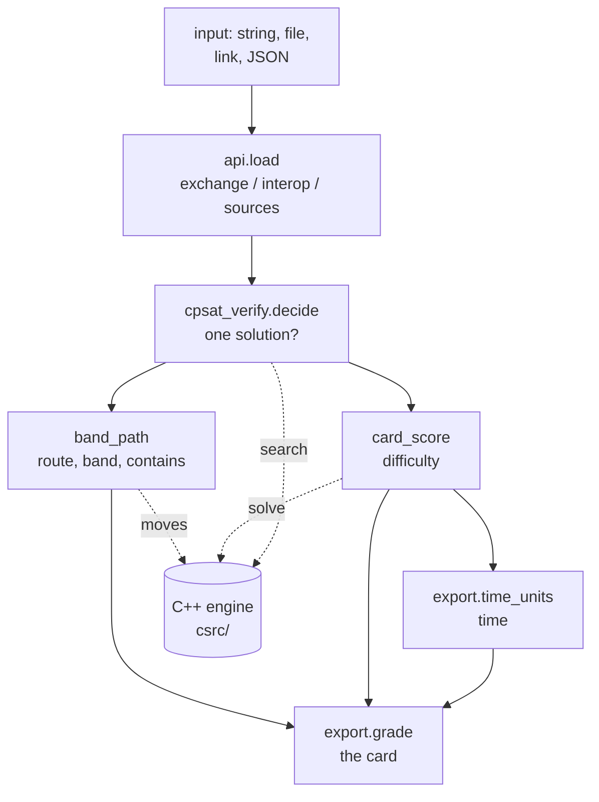
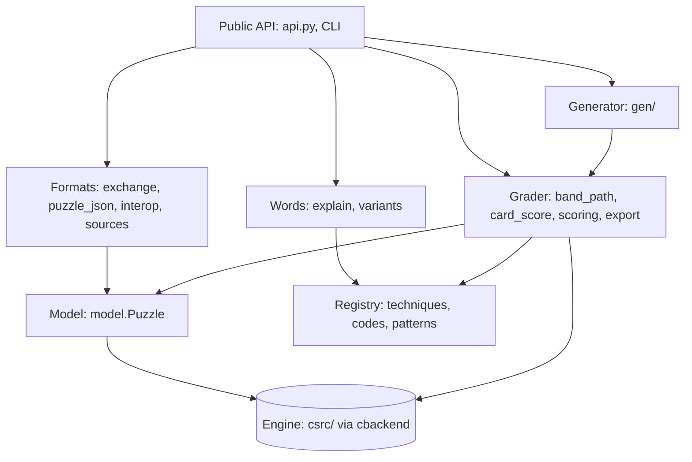

# Architecture

How pencilmark is put together: where each job lives, how a card is computed, and what must stay true. It names files
and functions so you can find them; it does not link to lines, which move. The code is being restructured (registries
for techniques, rule families and formats; a grader model object); this page describes the code as it is and is updated
with each step.

## What happens in `pencilmark.rate(puzzle)`



1. **Read.** `api.load` turns any accepted input (string, JSON, file, link) into a `model.Puzzle`. The public format is
   read by `exchange.py` (`sudoku-puzzle`, docs/FORMAT.md), text forms by `interop.py`, links by `sources/`.
2. **Check uniqueness.** `cpsat_verify.decide` runs the C++ search (`cbackend.brute_solve`), with OR-Tools as an optional
   fallback; it raises `NotUnique` / `NoSolution` / `Undecided`.
3. **Find the human route.** `band_path.band_path` solves band by band: at each position it asks the engine for every
   available move (`cbackend.state_moves`), names each one (`band_path.classify`) and takes the easiest. The result is
   the list of steps and the band.
4. **List the techniques.** `band_path.contents` re-runs the route with techniques banned to find the shortest list and
   the interchangeable ones (the chips in `contains`).
5. **Score.** `card_score.score_parts` prices every step and maps the average effort per cell to `difficulty`;
   `export.time_units` turns total effort and board size into `time` (`data/time_model.json`).
6. **Assemble.** `export.grade` builds the card with only the requested fields, each from its builder in the
   card-field registry (`export.FIELDS`, in the card's key order); `explain.py` writes step explanations,
   `publish_flags.py` the publishing checks, `se.py` the Sudoku Explainer-style rating.

## Layers



| Layer | Where | Owns |
|---|---|---|
| Public API | `api.py`, `__main__.py` (CLI) | entry points; nothing else imports them |
| Formats | `exchange.py`, `puzzle_json.py`, `interop.py`, `spec_format.py`, `sources/` | reading and writing puzzles, specs and cards |
| Model | `model.py` | the Puzzle: cells, houses, relations, constraints; compiled by `finalize()` |
| Engine | `csrc/` via `cbackend.py` | every search: techniques, move listing, brute force, refutation |
| Grader | `band_path.py`, `card_score.py`, `scoring.py`, `metrics.py`, `export.py`, `card.py`, `grader_model.py` | route, prices, difficulty, time, band, contents; `grader_model.py` holds every fitted parameter, loaded once |
| Words | `explain.py`, `variants.py`, `usage.py` | explanations, variant names and rule text |
| Generator | `gen/` | puzzles for a `sudoku-spec` request |
| Registry | `registry.py` over `data/techniques.csv`, `codes.csv`, `patterns.csv` | every fact about a technique, chip code and engine pattern code (name, band, order, family, flags, SE rating) |
| Data | `data/*.json`, `data/*.csv` | fitted parameters and tables |

## The engine (`csrc/`)

| File | Holds |
|---|---|
| `solver.hpp`, `solver.cpp` | technique ids, move records, pricing, the solve loop, basic techniques (singles, intersections, subsets, fish) |
| `model.hpp`, `model.cpp`, `nary.hpp`, `nary.cpp` | puzzle structure in C++; multi-cell constraints (cages, lines) and their propagation |
| `chains.cpp`, `colour.cpp`, `forcing.cpp` | X-chains and AICs, colouring and Medusa, forcing chains |
| `extra.cpp` | uniqueness (UR / BUG), almost locked sets, set-theory and digit-count logic |
| `sudokuwiki.cpp` | named patterns from Andrew Stuart's list (wings, Sue de Coq, fireworks, ...) |
| `human.cpp`, `mental.cpp` | variant techniques; the no-notes layer (what a solver sees without pencil marks) |
| `refute.cpp`, `desc.cpp`, `explain.cpp`, `canon.cpp`, `rich.cpp` | search-effort profile, move descriptors, explanation records, symmetry helpers, cognitive load |
| `bindings.cpp` | the pybind11 module `pencilmark._csolver` |

## Invariants

- **Deterministic.** The same puzzle gives the same card on every machine and in every process. Anything ordered by a
  Python set or by time is a bug. `tools/golden.py check` proves it for 55 puzzles.
- **Solver logic in C++.** Python names, prices and explains moves; it does not search the grid.
- **Formats are strict.** Unknown keys and reserved parts are refused with a message; format changes bump
  `format_version`.
- **Fitted numbers live in `data/`**, never inline, and each says where it came from.

## Known rough edges

Being fixed by the restructure (docs/dev/CODE_STYLE.md says how code should look):

- Adding a technique still touches the C++ engine (enum in `solver.hpp`, the technique, its tier, its descriptors), the
  constant in `solver.py`, a row in `data/techniques.csv` (and `codes.csv` for a new chip), its fitted price, its
  explanation and, for extra move fields, `cbackend.XMETA_KEYS`. `tests/test_registry.py` fails until the registry
  and the engine enum agree.
- A rule family is represented four times (public format, `puzzle_json`, `model.Puzzle`, the C++ spec).
- `explain.py` re-derives patterns the engine already found.
- Parameters are keyed by internal technique ids; `grader_model.py` loads them once, but they are not yet addressed
  by name.

## Changing things safely

```
python -m pytest -q -n auto tests             # about 10 seconds (30 s without -n)
python tools/golden.py check                  # every output of 55 puzzles must be identical (about 5 minutes)
```

A change that is meant to alter output rewrites the golden records (`tools/golden.py write`) in its own commit, with
the reason in the message.
