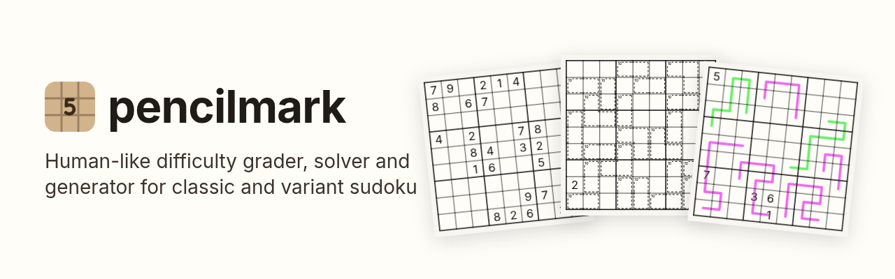

# pencilmark

<picture>
  <source media="(prefers-color-scheme: dark)" srcset="https://raw.githubusercontent.com/silly-puppyy/pencilmark/main/website/static/img/banner-dark.png">
  
</picture>

[](https://pypi.org/project/pencilmark/)
[](https://pypi.org/project/pencilmark/)
[](https://github.com/silly-puppyy/pencilmark/actions/workflows/wheels.yml)
[](https://github.com/silly-puppyy/pencilmark/blob/main/LICENSE)
[](https://silly-puppyy.github.io/pencilmark/)

pencilmark rates sudoku puzzles the way a human solver experiences them. It solves a puzzle step by step with human
techniques, easiest first, and reports how hard it is, how long it takes, which band it belongs to and which techniques
you need. It works for classic sudoku of any standard size and for many variants (killer, thermo, arrow, kropki, XV,
sandwich, multi-grid boards and more). It also solves puzzles, checks uniqueness, imports puzzles from [SudokuPad](https://sudokupad.app/),
[f-puzzles](https://www.f-puzzles.com/), [Penpa+](https://swaroopg92.github.io/penpa-edit/) and [Logic Masters](https://logic-masters.de/) links, and generates new puzzles to a target band or difficulty.

The engine is written in C++ ([pybind11](https://github.com/pybind/pybind11)). Results are deterministic: the same puzzle always gets the same card.

> **Written with AI.** Almost all of pencilmark's code, data analysis and documentation was written by an AI model
> ([Claude](https://claude.ai)), directed and reviewed by its maintainer. If you object to AI-written software, take that
> into account before you use it or contribute.

## Install

```
pip install pencilmark
pip install "pencilmark[verify]"      # recommended for variants: OR-Tools proves uniqueness where the engine's search runs out
```

Python 3.10 or newer. Building from source needs a C++17 compiler. Classics never need the `verify` extra; for hard
variants it often decides what the engine's own search cannot within its limits (in a screen of 1,351 Cracking the
Cryptic puzzles, 38 of the 53 that stayed undecided without it).

## Quick start

```python
import pencilmark

card = pencilmark.rate("....4.8.3.6...8..29.86.5..1235.........7..2.........96..2......8.12..7...9.......")
card["band"], card["difficulty"], card["time"]          # ('Hard', 5.8, 10.7)

card  = pencilmark.rate(puzzle, steps=True)             # add the step-by-step solve with explanations
cards = pencilmark.rate_many(puzzles, jobs=4)           # several puzzles in parallel, input order kept
sol   = pencilmark.solve(puzzle)                        # list of digits; raises NotUnique / NoSolution
doc   = pencilmark.read.plain(puzzle)                  # one format, strictly; read.sudokuwiki, .ipuz, .link, ...
text  = pencilmark.write.pencilmark(doc, solution=True) # pencilmark JSON; pencilmark.write.sudokuwiki, .ipuz, ...
```

A puzzle can be in any format pencilmark reads, detected: a classic string (`.` or `0` for blanks), a text grid, a
sudokuwiki.org string, a HoDoKu line, pencilmark JSON (a dict, its text or a `.json` path), an ipuz file, or a SudokuPad,
f-puzzles, Penpa or Logic Masters link. `rate(x, format="sudokuwiki")` names the format instead.

Command line:

```
$ echo '....4.8.3.6...8..29.86.5..1235.........7..2.........96..2......8.12..7...9.......' | pencilmark rate - --report
#1  Hard  -  difficulty 5.8  -  time 10.7 min
   contains: Naked Pair (or Hidden Pair), X-Wing (or 2-String Kite / Simple Colouring / Short chain in the head)

pencilmark rate puzzles.txt --json        # full card per line (python -m pencilmark works too)
pencilmark solve puzzles.txt              # the solution, or 'not unique' / 'no solution'
```

More in [Usage](https://silly-puppyy.github.io/pencilmark/start/usage/).

## The card

`rate` returns a `"pencilmark-grade"` card: by default the band (Very Easy to Extreme: what you need to know), the
difficulty (how hard the steps are to find, no ceiling; a newspaper medium is about 5), the predicted median solve time
in minutes, and the techniques the puzzle contains, easiest first. On request it adds publishing checks (candidate
steps that do little, a rule nobody needs, too many givens), the steps with explanations, time percentiles and more;
only requested fields are computed. A puzzle without exactly one solution has no card: `rate` raises `NotUnique` / `NoSolution`.
Every field is in [Grade card](https://silly-puppyy.github.io/pencilmark/formats/grade-card/).

## Puzzle format

Every entry point reads, and `pencilmark.write.pencilmark` writes, pencilmark JSON (`"format": "pencilmark-puzzle"`, format_version 1): every constraint is a
rule, houses included, each with one exact meaning and a default drawing, and an unknown key makes the reader refuse
the file instead of dropping a rule.

```json
{"format": "pencilmark-puzzle", "format_version": 1,
 "meta": {"title": "Heartstring", "author": "...", "source": "example.org", "type": "Killer Sudoku"},
 "board": {"rows": 9, "cols": 9},
 "digits": 9,
 "givens":   [0, 0, 5, 4, 0, ...],
 "solution": [6, 1, 5, 4, 2, ...],
 "rules": [
  {"type": "box_grid", "box": [3, 3], "count": [3, 3]},
  {"type": "cage", "sum": 15, "cells": ["r1c4", "r1c5", "r2c4"]},
  {"type": "edge", "kind": "kropki", "color": "white", "cells": ["r5c5", "r5c6"]}]}
```

The specification is [Puzzle format](https://silly-puppyy.github.io/pencilmark/formats/puzzle-format/) (JSON Schema:
[docs/pencilmark-puzzle.schema.json](https://github.com/silly-puppyy/pencilmark/blob/main/docs/pencilmark-puzzle.schema.json)).

### Other formats

For convenience pencilmark also reads and writes [sudokuwiki.org](https://www.sudokuwiki.org/) packed strings, text grids and [ipuz](http://www.ipuz.org/), reads pencil-mark grids, and loads SudokuPad,
f-puzzles, [Penpa+](https://swaroopg92.github.io/penpa-edit/) and Logic Masters links. None of these is needed to use the `pencilmark-puzzle` format; see
[docs/formats/other-formats.md](https://github.com/silly-puppyy/pencilmark/blob/main/docs/formats/other-formats.md). How rules map onto the engine is in
[docs/library/engine-mapping.md](https://github.com/silly-puppyy/pencilmark/blob/main/docs/library/engine-mapping.md); how to add
one, in [Add a rule kind](https://silly-puppyy.github.io/pencilmark/guides/development/add-rule-kind/).

## Supported rules

Classic sudoku from 4x4 to 25x25, irregular (jigsaw) regions, diagonals and extra regions, multi-grid layouts (samurai,
twodoku, butterfly, windmill and more), killer cages, little killers, sandwich, X-sums, skyscrapers, frame sums,
arrows, thermometers (normal and slow), German and Dutch whispers, renban, region-sum, palindrome, zipper, between,
entropic, modular and parity lines, kropki, XV, greater-than, difference / ratio dots, anti-knight, anti-king,
non-consecutive, odd / even, low / high, Rossini, Vudoku, equal sums, counting rules, and given candidates (Sukaku).
Rules that cannot be translated exactly are refused, never dropped silently.

## Generator

```python
r = pencilmark.generate({"format": "pencilmark-spec", "format_version": 1,
                         "board": {"rows": 9, "cols": 9}, "digits": 9,
                         "rules": [{"type": "box_grid", "box": [3, 3], "count": [3, 3]}],
                         "where": {"band": "Hard"}})
r["puzzle"], r["card"], r["info"]       # pencilmark-puzzle, its card, run details
```

The request is a `pencilmark-spec` ([docs/formats/generator-spec.md](https://github.com/silly-puppyy/pencilmark/blob/main/docs/formats/generator-spec.md)).

Targets: band, a difficulty range or the hardest / easiest found, required techniques, symmetry, given counts (per
grid on a multi-grid layout), and rule elements with counts and shape limits (cages, thermos, whispers, renban, between
lines, arrows, kropki, XV, parity). Boards: one grid, or a named multi-grid layout such as samurai, with locked rules of
different digits. Every result is checked for uniqueness.

## Puzzle sources

```python
card = pencilmark.rate("https://sudokupad.app/...")  # SudokuPad, f-puzzles, Penpa+, Logic Masters, short links
doc = pencilmark.read.link("https://sudokupad.app/...")  # the same puzzle as pencilmark JSON (a dict)
```

The command line takes links too: `pencilmark rate links.txt`, one link per line.

Loaders that fetch pages identify themselves, obey robots.txt and pause between requests. Override the user agent with
the `PENCILMARK_UA` environment variable.

## Limitations

- Bands and difficulty measure different things. The band is the hardest technique a puzzle needs; difficulty is how
  hard it is overall. A puzzle that needs one X-Wing (Hard) is often easier than a long Medium one, and solvers agree
  ([philosophy](https://silly-puppyy.github.io/pencilmark/grades/philosophy/)). This is by design, not an error.
- Difficulty and time are models fitted to human solving data. Differences under one point of difficulty are not
  meaningful, and a single solve can vary a lot from the predicted time.
- Bands depend on the technique catalogue; a puzzle that needs a technique the engine does not have is solved with
  Trial and error at that point and rated Extreme.
- Very hard puzzles with many-cell rules (killers, arrows, palindromes, thermos) can take minutes while the technique list
  (`contains`) is made minimal; use `max_seconds` to cap it (the card then says `completed: false`).
- The Sudoku Explainer-style ratings (`se=True`) are approximate and meaningful for classic sudoku only.

## Benchmark

On a frozen held-out set of 7,623 puzzles with real human solve data from seven sources, pencilmark's difficulty ranks
puzzles by human solve time at Spearman 0.61 to 0.80 within each group, closer than four established graders on the same
classics. Details: [docs/grades/benchmark.mdx](https://github.com/silly-puppyy/pencilmark/blob/main/docs/grades/benchmark.mdx).

## Known issues

Being worked on after 1.0:

- **Speed.** Grading takes a median 0.49 s per puzzle on the benchmark (classics 0.04 s; 90th percentile 3.8 s), and
  the slowest few percent take 10 s to minutes. Sudoku Explainer and HoDoKu answer in under a millisecond (they do not
  model human solving), Rangsk's solver in 0.07-0.13 s. Use `max_seconds` to bound a call.
- **Generator speed and range.** About 20-70 s per puzzle that meets a spec (HoDoKu: 0.05-1 s), and classic Extreme puzzles
  are not reached within the default 120 s.
- **Variants on one scale.** On classics, difficulty matches established ratings of the same puzzles; across variant
  types the same difficulty does not yet mean the same experience (puzzle types differ by about 2 points on average, and
  variants often score above the classic range of their band). Time is most off for the same reason (about 1.4x per
  puzzle type).
- **The ends of the scale.** Between about 2 and 8, each point of difficulty means about 20-40% more solving time per
  cell. Above about 8 a point is worth less time (5-15% on three sources). Below 2 the scale is gentler (about the square root of
  effort, so it never goes negative); there it predicts solve times about 1.5% worse than a pure log scale would.
- **Uniqueness on some killers.** A few large killers get band Unknown (uniqueness not settled) without OR-Tools
  (`pip install "pencilmark[verify]"`) although human logic solves them.

## License

MIT, see [LICENSE](https://github.com/silly-puppyy/pencilmark/blob/main/LICENSE).
