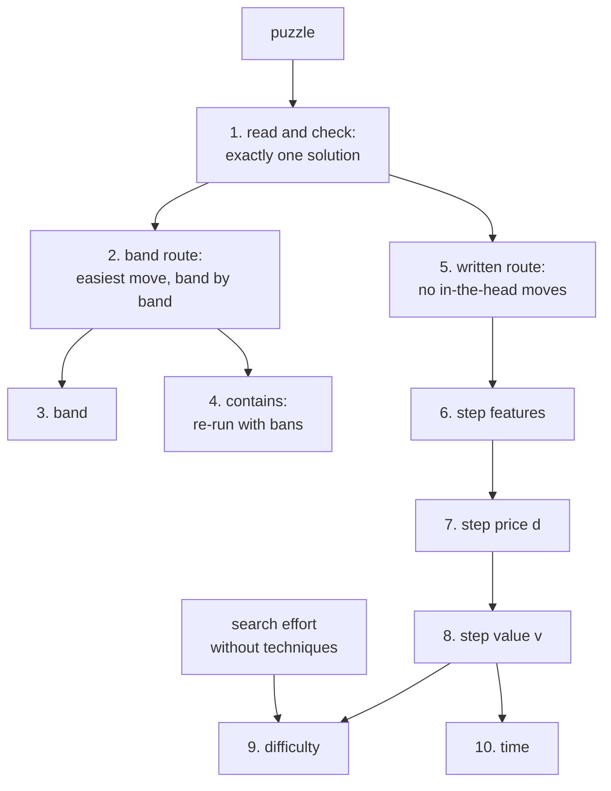

import DifficultyCurve from '@site/src/components/DifficultyCurve';

# How a card is computed

pencilmark solves the puzzle the way a person would, prices every step, and turns the prices into three numbers:
**band** (what you need to know), **difficulty** (how hard the steps are) and **time** (how long it takes). The diagram
is the map of this page; click a box to go to its section. [Philosophy](PHILOSOPHY.md) says what the numbers are meant
to mean; the [benchmark](BENCHMARK.mdx) says how well they do.

## 1. Read and check

The input is read into the engine's model of the puzzle: cells, houses and rules (`api.load`). The engine's exhaustive
search then proves there is exactly one solution (`cpsat_verify.decide`); with OR-Tools installed, CP-SAT takes over if
that search hits its node limit. A puzzle with no solution or several is refused before anything is graded.

## 2. The band route

The band route is the order of steps a person would take, choosing the easiest move each time:

1. At each position the engine lists every move it can find (`cbackend.state_moves`), up to eight per technique.
2. Each move is named by its most specific shape (`band_path.classify`): an X-Chain of length 4 with its ends in one
   box is a Skyscraper, not a long X-Chain. The shape decides the band of the move.
3. The engine searches band by band: first only Very Easy techniques, then up to Easy, and so on. In the first band
   that has a move, it takes the move with the lowest study order in [`codes.csv`](TECHNIQUES.md) (a hidden single
   before a naked single, a pointing pair before a naked pair), the cheaper one on a tie.
4. The move is applied and the route goes on until the grid is full.

Where no technique applies, the engine proves an elimination by full search (Trial and error, Extreme); with
`allow_guessing` it guesses instead and the band is Unknown.

## 3. Band

The band is the band of the hardest step on the band route: Very Easy, Easy, Medium, Hard, Very Hard, Expert or
Extreme. [Techniques](TECHNIQUES.md) lists the band of every technique and shape.

## 4. Contains

`contains` is the shortest list of techniques that still solves the puzzle at its band. The route is re-run with
techniques banned: a technique stays on the list only if, without it, the puzzle needs a harder band or a harder
technique. A second search finds the **alternatives**: techniques that, banned one at a time, could take each listed
technique's place. They share a chip (`XWG/KTE/SCL`).

## 5. The written route

Difficulty and time are priced on a second route (`card_score.steps`): the engine's own solve, cheapest move first,
without the moves people do in their head (pairs, short chains and case splits seen without notes). It models a
solver who writes candidates. Variant techniques are switched on only for puzzles with the matching rules.

## 6. Step features

Every step of the written route carries facts about its move, measured by the engine (`desc.cpp`, `meta8`):

| Feature | Meaning |
|---|---|
| cells (log) | cells the move uses |
| houses (log) | houses and rules it uses |
| digits (log) | different digits it eliminates or places |
| links | links in its chain or pattern |
| hidden | 1 for a hidden form (digit positions), 0 for a naked one (cell contents) |
| arithmetic | 1 when it adds or compares sums |
| relation | 1 when it reads pair rules (dots, whispers, anti-knight) |
| notes | 1 when it needs written candidates |
| spread (log) | how far apart its cells are |
| branches, depth (log) | branching and depth of the search it took |
| search, uniqueness, counting, contradiction | 1 when it searches, assumes uniqueness, counts digits, or ends in a contradiction |
| held, coverage | how much it must hold in mind; how much of the grid it covers |

## 7. Step price

A step's price $d$ is log-linear in its features $x$:

$$
\ln d = \theta \cdot x \;+\; \lambda_1\, \text{depth}\cdot\ln\text{cells} \;+\; \lambda_2\, \text{depth}\cdot\text{links} \;+\; \lambda_3\, \text{depth}\cdot\ln\text{branches}
$$

- $\theta$ (18 weights) and $\lambda$ (3) are fitted so that the difficulty of section 9 ranks puzzles like human solve
  times (`data/price_params.json`, `meta_theta_full`, `meta_theta_interact`). The largest weights are on the digits a
  move involves, written notes, the houses it uses and its spread: a move over many digits and houses, which needs
  candidates written down and spans the grid, is hard to see.
- $\ln d$ is capped at $\ln 1000$, and no step costs more than a guess would: above that price it grows only
  logarithmically.
- Placements made without notes add the cost of the scan that finds them (the `K` weights per kind of scan).
- Boards larger than 9×9 do not raise the price of a step; they add time instead (section 10).

## 8. Step value

Each step's value combines its price with how hard it is to find:

$$
v_i = d_i^{\beta}\; F_i\; e^{\delta_i}, \qquad F_i = \frac{20\, C_i / 727}{\text{moves offered}_i}
$$

- $\beta = 4.58$ (fitted): a hard step counts far more than several easy ones.
- $C_i$ is the number of candidates left on the grid; $20 C_i / 727$ is Andrew Stuart's density measure, so a step in
  a crowded grid is harder to find. On boards larger than 9×9 the density is taken relative to the board's size.
- Dividing by the number of equally good moves on offer makes a step easier when several would do.
- $\delta_i = 0.1 \times \ln$(the number of digit combinations of the cages its cells touch; the largest, 0 without
  cages): a cage with many possible fillings is harder to work with.

## 9. Difficulty

Difficulty is the average value per empty cell, on a logarithmic scale, plus a technique-free search term:

$$
\ell = \ln \frac{\sum_i v_i}{\text{empty cells}} \;+\; 2\,\ln\!\Big(1 + \frac{1}{\text{empty cells}} \sum_{\text{stuck points}} \ln\frac{C}{R}\Big),
\qquad r = \frac{2\,\ell}{\ln 5}
$$

The second term is the work of searching when no technique applies: at each point where simple logic is stuck, the
engine tries every candidate ($C$) and counts how many fail quickly ($R$) (`refute.cpp`). It is the only part that
knows nothing about techniques.

$r$ is then mapped to the familiar scale. From difficulty 2 upwards one point means the same everywhere: about **2.6
times the effort per cell**. Below 2 the map turns gentler (difficulty proportional to roughly the square root of
effort), so very easy puzzles keep apart and no puzzle goes below 0.

<DifficultyCurve />

Dividing by the number of empty cells is what makes difficulty a measure of hardness, not amount: a 16×16 classic with
the same kind of steps as a 9×9 gets the same difficulty and a longer time.

## 10. Time

Time uses the step values of the production prices (`data/params.json`) with their own exponent, $\beta_t = 3.81$:

$$
L = \ln \sum_i d_i^{\beta_t} F_i\, e^{\delta_i}, \qquad
t = 11.8\ \text{min} \times \Big( e^{\,a + k_e L + k_n \ln n + g} + t_0 \Big)
$$

- $n$: the number of empty cells; $k_e = 0.29$, $k_n = 0.74$, $a$ and $t_0$ are fitted on per-player solve times
  (`data/time_model.json`).
- $g$: scanning cost of irregular regions (jigsaw pieces, extra regions per cell).
- 11.8 min is the median time of a classic 9×9.
- Very long predictions grow more slowly, and boards with more than about 92 empty cells (16×16, multi-grid layouts)
  take longer per cell than the power law alone gives.

`time` is the median player; `time_pNN` and `time_mean` spread it over the players with a log-normal shape (wider for
classics than for variants).

## Where the numbers live

| Part | Code | Parameters |
|---|---|---|
| route, band, contains | `band_path.py` | `data/techniques.csv`, `data/codes.csv` |
| step features | `csrc/desc.cpp`, `csrc/human.cpp` | – |
| step price | `scoring.py` | `data/price_params.json` (difficulty), `data/params.json` (time) |
| step value, difficulty | `card_score.py` | `data/card_score.json` |
| search effort | `csrc/refute.cpp` | `data/card_score.json` (`refute_w`) |
| time | `export.time_units` | `data/time_model.json` |
