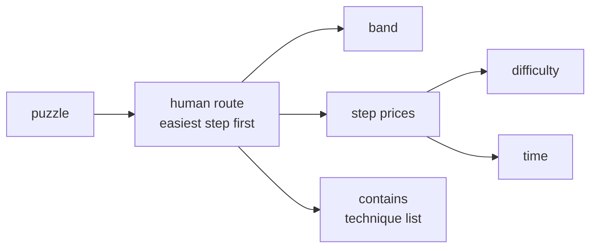

import DifficultyCurve from '@site/src/components/DifficultyCurve';

# How a card is computed

pencilmark solves the puzzle the way a person would, prices every step, and turns the prices into three numbers:
**band** (what you need to know), **difficulty** (how hard the steps are) and **time** (how long it takes). This page
follows one card from start to finish. [Philosophy](PHILOSOPHY.md) says what the numbers are meant to mean; the
[benchmark](BENCHMARK.mdx) says how well they do.

## 1. The route

The engine lists every move available in the current position and takes the easiest one, then repeats until the grid is
full. "Easiest" means the lowest band first, then the textbook order inside the band (a hidden single before a naked
single, a pointing pair before a naked pair). Each step records its technique and a few facts about the move: how many
cells and houses it uses, how many digits it removes, how long its chains are.

Two routes are used. The **band route** (`band_path.band_path`) decides the band and the technique list. The **written
route** (`card_score.steps`) is the one priced for difficulty and time; it first leaves out the moves people do in their
head, so it matches a solver who writes candidates.

## 2. Band

The band is the band of the hardest technique on the band route. Bands are a learning path, from scanning (Very Easy)
to trial (Extreme); every technique's band is listed in the technique registry (`data/techniques.csv`).

The technique list (`contains`) comes from re-running the route with each technique banned: a technique stays on the
list only if, without it, the puzzle needs a harder band or a harder technique.

## 3. Step prices

Each step $i$ gets a value

$$
v_i = d_i^{\beta}\, F_i\, e^{\delta_i}
$$

- $d_i$: the move's price: a fitted price for its technique, adjusted by the move's facts (its size, its chain length);
- $\beta = 4.58$: how much harder steps count than easy ones (fitted);
- $F_i$: how crowded the grid still is with candidates, divided by the number of equally good moves on offer (a step
  is harder to find in a full grid, easier when several moves would do);
- $\delta_i$: a small term for cages and pair clues with many digit combinations.

## 4. Difficulty

Difficulty is the average price per empty cell, on a logarithmic scale:

$$
c = \frac{\sum_i v_i}{\text{empty cells}}, \qquad r = \frac{2 \ln c}{\ln 5}
$$

$r$ is then mapped to the familiar scale. From difficulty 2 upwards one point means the same everywhere: about **2.6
times the effort per cell**. Below 2 the map turns gentler (difficulty proportional to roughly the square root of
effort), so very easy puzzles keep apart and no puzzle goes below 0.

<DifficultyCurve />

Dividing by the number of empty cells is what makes difficulty a measure of hardness, not amount: a 16×16 classic with
the same kind of steps as a 9×9 gets the same difficulty and a longer time.

A technique-free term adds the work of searching when no technique applies: the engine tries every candidate at each
point where the route is stuck and counts how quickly each one fails.

## 5. Time

Time uses the same steps with their own weights:

$$
t = 11.8 \text{ min} \times \left( e^{\,a + k_e L + k_n \ln n} + t_0 \right)
$$

- $L$: the log of the summed step values (time weights);
- $n$: the number of empty cells;
- $k_e = 0.29$, $k_n = 0.74$, $a$ and $t_0$: fitted on per-player solve times;
- 11.8 min: the median time of a classic 9×9.

Two corrections follow: very long predictions grow more slowly, and boards with more than about 92 empty cells
(multi-grid layouts, 16×16) take longer per cell. `time` is the median player; `time_pNN` spreads it over the players
with a log-normal shape.

## Where the numbers live

| Part | Code | Parameters |
|---|---|---|
| route and band | `band_path.py` | `data/techniques.csv` |
| step prices | `scoring.py`, `card_score.py` | `data/params.json`, `data/price_params.json` |
| difficulty map | `card_score.score_parts` | `data/card_score.json` |
| time | `export.time_units` | `data/time_model.json` |
