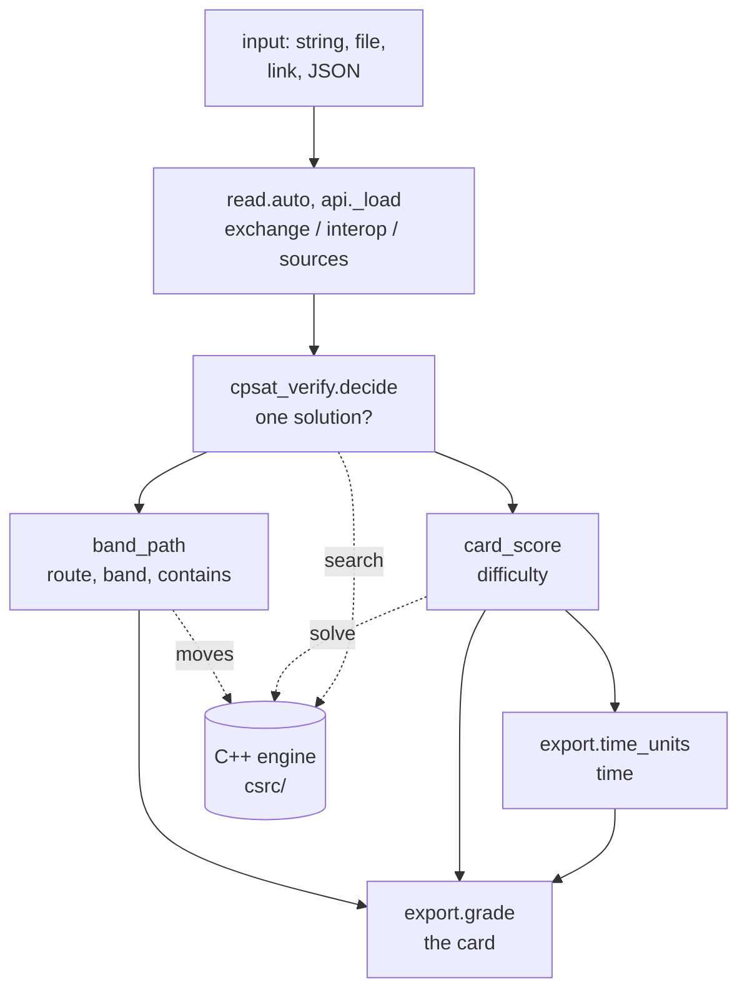
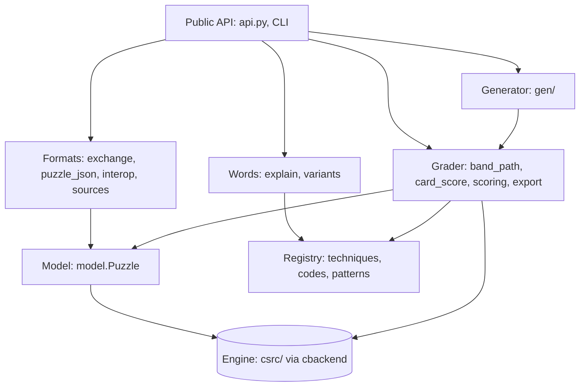

# Architecture

How pencilmark is put together: where each job lives, how a card is computed, and what must stay true. It names files
and functions so you can find them; it does not link to lines, which move. The code is being restructured (registries
for techniques, rule families and formats; a grader model object); this page describes the code as it is and is updated
with each step.

## What happens in `pencilmark.rate(puzzle)`



1. **Read.** `read.auto` detects the input's format and reads it into a pencilmark JSON dict (`read.py`: one reader per
   format; text forms in `interop.py`, links in `sources/`); `api._load` builds the `model.Puzzle` from it through
   `exchange/` (`pencilmark-puzzle`, docs/formats/puzzle-format.md).
2. **Check uniqueness.** `cpsat_verify.decide` runs the C++ search (`cbackend.brute_solve`), with OR-Tools as an optional
   fallback; it raises `NotUnique` / `NoSolution` / `Undecided`.
3. **Find the human route.** `band_path.band_path` solves band by band: at each position it asks the engine for every
   available move (`cbackend.state_moves`), names each one (`band_path.classify`) and takes the easiest. The result is
   the list of steps and the band.
4. **List the techniques.** `band_path.contents` re-runs the route with techniques banned to find the shortest list and
   the interchangeable ones (the chips in `contains`).
5. **Score.** `card_score.score_parts` prices every step and maps the average effort per cell to `difficulty`;
   `export.time_units` turns total effort and board size into `time` (`data/time_model.json`).
6. **Assemble.** `export.grade` builds the card with only the requested fields, each from its builder in the
   card-field registry (`export.FIELDS`, in the card's key order); `explain/` writes step explanations,
   `publish_flags.py` the publishing checks, `se.py` the Sudoku Explainer-style rating.

## Layers



| Layer | Where | Owns |
|---|---|---|
| Public API | `api.py`, `__main__.py` (CLI) | entry points; nothing else imports them |
| Formats | `exchange/` (common, board, validate, read, write, canonical), `rules/`, `puzzle_json.py`, `interop.py`, `spec_format.py`, `sources/` | reading and writing puzzles, specs and cards |
| Model | `model.py` | the Puzzle: cells, houses, relations, constraints; compiled by `finalize()` |
| Engine | `csrc/` via `cbackend.py` (`engine_records.py` decodes its move records) | every search: techniques, move listing, brute force, refutation |
| Grader | `band_path.py`, `card_score.py`, `scoring.py`, `metrics.py`, `export.py`, `card.py`, `grader_model.py` | route, prices, difficulty, time, band, contents; `grader_model.py` holds every fitted parameter, loaded once |
| Words | `explain/` (base, grid, catalog, singles, combos, notes, chains, trial, records, dispatch), `variants.py`, `usage.py` | explanations, variant names and rule text |
| Generator | `gen/` | puzzles for a `pencilmark-spec` request |
| Registry | `registry.py` over `data/techniques.csv`, `codes.csv`, `patterns.csv` | every fact about a technique, chip code and engine pattern code (name, band, order, family, flags, SE rating) |
| Data | `data/*.json`, `data/*.csv` | fitted parameters and tables |

## The engine (`csrc/`)

| File | Holds |
|---|---|
| `solver.hpp`, `solver.cpp` | technique ids, move records, pricing, strategies and tiers, the solve loop, fallbacks (`solver_util.hpp`: shared helpers) |
| `direct_view.cpp`, `notes_view.cpp`, `nary_moves.cpp` | the no-notes view; techniques on written candidates (singles, intersections, subsets, fish, wings, coloring); moves of cages, lines and sums |
| `brute_force.cpp` | exhaustive search (uniqueness, generator) |
| `model.hpp`, `model.cpp`, `nary.hpp`, `nary.cpp` | puzzle structure in C++; multi-cell constraints (cages, lines) and their propagation |
| `chains.cpp`, `color.cpp`, `forcing.cpp` | X-chains and AICs, coloring and Medusa, forcing chains |
| `uniqueness.cpp`, `als.cpp`, `set_logic.cpp` | uniqueness (UR / BUG) and implied houses; almost locked sets; set theory, digit counting, sum algebra, band logic (`move_util.hpp`: their shared helpers) |
| `sudokuwiki.cpp` | named patterns from Andrew Stuart's list (wings, Sue de Coq, fireworks, ...) |
| `variant_logic.cpp`, `mental.cpp` | variant techniques; the no-notes layer (what a solver sees without pencil marks) |
| `refute.cpp`, `desc.cpp`, `explain.cpp`, `canon.cpp`, `loads.cpp` | search-effort profile, move descriptors, explanation records, symmetry helpers, cognitive load |
| `listing_cache.cpp` | the listing caches (below) |
| `bindings.cpp` | the pybind11 module `pencilmark._csolver` |

A card lists the same positions many times: band by band at each step, again in every banned-technique route of the
technique list, and again in the card's solves. `listing_cache.cpp` keeps, per thread, what each strategy found at an
exact position. The disabled-technique flags a strategy reads are recorded as it reads them (`Flags`), so a stored
result is reused only where those flags match. Single-digit techniques (fish, pattern overlay) also memoize per digit,
on that digit's candidates. Both caches keep two generations within a fixed budget. `_csolver.listing_cache(False)`
turns them off; `tests/test_listing_cache.py` checks that the move lists stay the same. `band_path` also lists the
costliest late techniques (`LATE`) only when they could still give the move it picks (`state_moves(skip=...)`).

## Invariants

- **Deterministic.** The same puzzle gives the same card on every machine and in every process. Anything ordered by a
  Python set or by time is a bug, and so is a result that depends on what a cache already holds. `tools/golden.py check`
  proves it for 55 puzzles.
- **Solver logic in C++.** Python names, prices and explains moves; it does not search the grid.
- **Formats are strict.** Unknown keys and reserved parts are refused with a message; format changes bump
  `format_version`.
- **Fitted numbers live in `data/`**, never inline, and each says where it came from.

## Where things go

Most facts live in one table that everything else reads; a new feature adds a row there and code only where the
behavior is new.

| To add | The table to extend | Code that still has to be written |
|---|---|---|
| A technique | a row in `data/techniques.csv` (band, family, flags, starting `price`; a chip code in `codes.csv`, a shape in `patterns.csv`) | the C++ search, its tier and enum entry, the `solver.py` constant, an explanation handler ([Add a technique](add-technique.md)) |
| A rule kind of an existing family (line, edge, cell) | its kind in `rules/line.py`, `rules/edge.py` or `rules/cell.py` (name, parameters, text, drawing, generated) | its engine expansion where the kind is new ([Add a rule kind](add-rule-kind.md)) |
| A reusable custom rule | nothing: a `definitions` entry in the puzzle file (6.18) | |
| A board layer (regions to find, shading, ...) | a row in `layers.py` (custom-language function, rule type, name) | what the engine, the card and the renderer do with it |
| A normalization of input documents | `exchange.common.prepared()` (validation, reading and the fingerprint all call it) | |
| A card field | `export.FIELDS` (name, builder), documented in `grade-card.md` (a test checks the two agree) | the builder |
| A quality check | `publish_flags.CHECKS` and `QUALITY` (limit), documented in `grade-card.md` (checked too) | the check function |
| A generator template | `spec_format.GEN_KINDS` follows the `generated` flag of the rule kind | the element search in `gen/elements.py` |

## Known rough edges

Being fixed by the restructure (docs/dev/code-style.md says how code should look):

- Adding a technique still touches the C++ engine (enum in `solver.hpp`, the technique, its tier, its descriptors) and
  the constant in `solver.py`, besides its table row and explanation; `tests/test_registry.py` fails until the
  registry and the engine enum agree.
- Rule kinds: reading, writing and validation are still if / elif chains over rule types (`exchange/read.py`,
  `write.py`, `validate.py`), and `model.py` compiles lines with its own chain; moving that onto the kinds in
  `rules/*` is the next step.
- Layers: regions to find and coloring share the engine's annotation effects, but the route (`band_path.py`) still
  branches on each; a layer protocol (state, effects, explanation, drawing) would let a new layer plug in.
- A rule family is represented four times (public format, `puzzle_json`, `model.Puzzle`, the C++ spec).
- `explain/` takes each move's pattern from the engine's record, but most handlers still rebuild it to check it
  and to word it.
- Parameters are keyed by internal technique ids; `grader_model.py` loads them once, but they are not yet addressed
  by name.

## Changing things safely

```
python -m pytest -q -n auto tests             # about 10 seconds (30 s without -n)
python tools/golden.py check                  # every output of 55 puzzles must be identical (about a minute)
```

A change that is meant to alter output rewrites the golden records (`tools/golden.py write`) in its own commit, with
the reason in the message.
